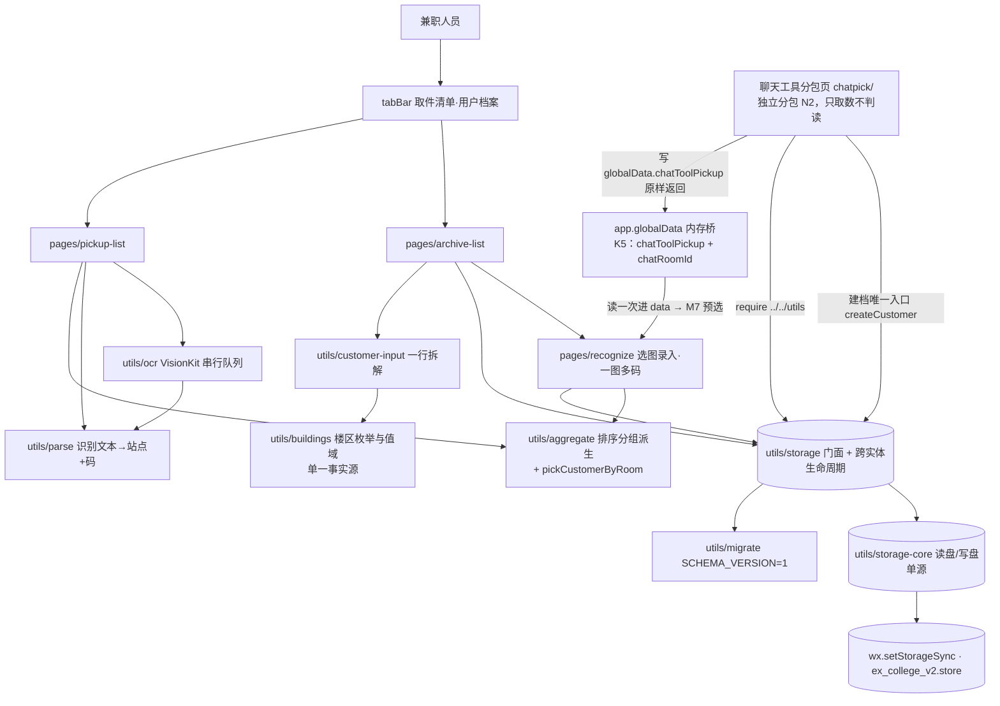

# ARCHITECTURE · 架构总览 v2（≤100 行；agent 写代码前必读）
> 本文件回答三件事：系统由什么组成 / 数据怎么流 / 新代码放哪。
> ⚠️ **写作纪律**：每节都显式区分「**已实现**」与「**规划**」。规划中的模块**不进模块图的实线**，
> 也不得被引用为"已有能力"。24 卡审查按"文档与代码是否相符"查这里。
> ⚠️ **数字口径**（报告 R-14 第二次踩之后改的规矩）：本文件**不写实测数字**（行数、文件数、断言条数、门禁项数），
> 只写取数命令。要数字请实测：`node tools/check.js | tail -2` ｜ `node tools/selftest.js | tail -2` ｜ `git diff --shortstat <锚点>..HEAD`。

## 1. 已实现（每节状态最后一次人工核对：2026-09-24 · r2 审查；数字请实测）
| 层 | 位置 | 状态（核对来源＝报告 R-15 订正 + r2 乙逐条核实） |
| :-- | :-- | :-- |
| 应用外壳 | `app.js` / `app.json` / `app.wxss` | 已实现：`pages` 登记三页、`pages[0]` = `pages/pickup-list/index`、**`tabBar` 两格已上**（不带图标）；**2026-09-25 改判：`subPackages` = `chatpick`（**独立分包**，带 `independent: true`）+ `chatTools` 已配**（原为"普通分包"，U-1 实测 `-80426 should be independent` 后被平台否掉），**同一处分包项还要 `renderer: "skyline"`**（U-1 第二半读数 `should be in renderer skyline`）；仍**不碰** `window.navigationStyle`。`globalData.chatRoomId` 现在**有写入方了**（唯一写入点 = `chatpick/index.js`） |
| 页面层 | `pages/pickup-list/`、`pages/archive-list/`、`pages/recognize/`（+ 本页专用件 `pages/recognize/form-parts.js`） | 已实现：清单（站点分组 + 勾选已取件 + **M13 顶部「＋ 录快件」**）、档案（列表 + 手动建档浮层）、录入（两条取图来源 + 识别预填 + 一图多码全存 + **M14 三段布局：上常驻 / 中 `scroll-view` / 下常驻保存**）。11 卡的 `pages/index/` 占位页已删除 |
| 聊天工具分包页 | `chatpick/index.*`（**独立分包**，⛔ **引不到主包 `utils/`**） | 已实现（2026-09-25 改判 N2 后收窄）：只调 `wx.openChatTool` / `wx.getChatToolInfo`，把**平台原样返回**塞进 `app.globalData.chatToolPickup`（内存桥）再 `switchTab` 去档案格；**不判读、不脱敏、不建档、屏上不出现任何平台原文**（能那样做的代码在引不到的主包）。绑定 + 取 id + 拆三段 + 落库全部在 `pages/archive-list/` ⇒ 规则仍只有一份。⚠️ 独立分包里 `getApp()` 与主包 `app.wxss` 是否按预期生效 = **U-7，未取证** |
| 平台边界 | `utils/chat-tool.js` | 已实现：`openChatTool` / `getChatToolInfo` / `isChatTool` / `getApiCategory` 的**唯一**调用点，全靠依赖注入（Node 侧测得到超时、取消、无接口、有键但空、没有那个键五种出口）；`fingerprint` / `maskRoomIds` 是 D3 会话标识上屏的唯一脱敏口 |
| 纯函数与存储层 | `utils/` | 已实现：**6 个逐字节搬运自 v1**（`buildings`/`customer-input`/`stations`/`parse*`/`ocr`/`privacy`）+ **3 个搬后局部改**（`storage`/`aggregate`/`parcel-drafts`⚠️ 本批改了它的**行状态**推导（R-36 + r2 的 R2-C05/C06：`unknown`/`needStation` 收进 `withFlags` 一处算）⇒ 不再逐字节一致，差异＝该文件里带报告编号的那几个 hunk）+ 3 个新写（`migrate`/`reason`/`chat-tool`）＋ **2026-09-25 卡 52 拆 TD-001**：原 `storage`（拆分前 758 非空行）拆为 `storage-core`（读盘/写盘**单源**）/ `storage-customers` / `storage-parcels` + `storage`（门面 + 跨实体生命周期；依赖单向、**导出面 30 名逐名不变**）。逐字节与否取数：`certutil -hashfile` 与 v1 同名件比对 |
| 机械门禁 | `tools/check.js` | 判据清单在 `check.ps1` 头部注释里逐条列名（**条数与项数不写死**，取数：`node tools/check.js \| tail -2`）。⚠️ **2026-09-25 用户裁决删掉两条候选判据**：`chatTools` ↔ `subPackages` ↔ 分包页形态对帐（原 P-A）与"没有悬挂的 `if`"（原 P-B）⇒ **K2 的形态与"装配吃行"这两处现在没有机器闸**，性质与后果记在 `docs/TECH_DEBT.md` TD-014。**波 5 起把分包页一起纳入**：三件套、JS 语法、class 对帐、存储越界此前只扫 `pages/` 与 `utils/`，`chatpick/` 全裸奔。报告 R-29/R2-C01 查出的假绿通道已全部关掉（变异可复现，见 r2 报告 §3）；`app.json` 顶层键拼错判据保留，并含 r4 R4-06 补的**相邻转置**（`cahtTools` 也判红）。**每批另跑锚点门禁 `gate.ps1`**（锚点 / 范围 / 行数 / lockfile 四件；退出码 0=绿 1=红 2=黄；`-ScopeFiles` 传**一个逗号分隔字符串**；git 路径读取一律 `-c core.quotepath=false`） |
| 行为自测 | `tools/selftest.js` ＋ `tools/selftest-wave5.js` ＋ `tools/selftest-wave6.js` | 已实现并接回 `check.ps1`（M12），含 `addParcels` 原子性断言组（R-10）与草稿行一致性断言组（R-36）。条数取数见文件头那条命令；⚠️ 文件内 `EXPECTED_ASSERTIONS` 钉死了预期条数，加/删断言必须同步改它（R2-C04）。**拆分沿革（都是"测试文件 ≤1000 行"逼出来的）**：§10 平台边界 + §11b/§11c 建档浮层 住 `selftest-wave5.js`；**§11 页面零件（录入页）自 2026-09-25 范围扩展批起住 `selftest-wave6.js`**（wave5 撞线后整体搬走，函数与断言一条不动）。判定器 `eq`/`check` 由 `selftest.js` 注入，**三个文件只有一套计数器**（否则"断言 N 条"这个读数会作伪）。异步链另有看门狗：Promise 不结算就打印判红并 `exit 1`（R3-02） |
| 收工仪式 | `check.ps1` | `$STEPS = @('node tools/check.js', 'node tools/selftest.js')`，退出码 0 = 可说"完成" |

## 2. 分层铁律（继承 v1，与"是否已实现"无关的约束）
1. **页面不直接读写本地存储**：`wx.*Storage*` 只允许出现在 `utils/` 下——`tools/check.js` 第 6 条机械拦（v1 的冒烟件第一版就是被这条判红的，判据被证明有效）
2. **纯逻辑与副作用分文件**：排序/分组/解析/校验写成纯函数（同输入必同输出、零 `wx.*`），副作用集中到 `utils/storage-core.js`（**读盘/写盘单源**；对外门面 = `utils/storage.js`）与页面事件层
3. **单一事实源**：同一规则只允许有一处实现。楼区枚举与值域只在 `utils/buildings.js`；错误码文案只在 `utils/reason.js`；可转发页集合从 `app.json` 派生
4. **依赖显式传入**：平台能力（OCR、聊天工具接口）通过参数注入进纯函数，Node 侧才能测失败分支
5. 单文件 ≤500 行、函数 ≤50 行（AGENTS.md §11）

## 3. 新代码落点表（新建文件前必查；找不到就问，禁止乱放）
| 改动类型 | 放哪 | 何时产生 |
| :-- | :-- | :-- |
| 新页面 | `pages/<页面名>/` + 在 `app.json` 的 `pages` 登记（漏登记 = 门禁 FAIL） | 23 卡第一批 |
| 档案详情页（`pages/customer-detail/`） | 页面 4 件套 + `parts.js`（纯函数）；**键格式化跨页复用** `pages/archive-list/sheet-flow.js`（⛔ 不写第二份） | 2026-09-25 详情页批 |
| 底部导航 | `app.json` 的 `tabBar`（**只声明**，项目零图片资源 ⇒ 不带图标） | 23 卡第一批（两格出现后才有意义） |
| 业务纯函数 | `utils/`，一个主题一个文件 | 23 卡起 |
| 解析层（文本 / 站点 / 取件码） | 门面 `utils/parse.js`（**只导出 `parseParcelText` / `parseParcelTextMulti`**）；实现三件：`parse-text.js`（叶层、零内部依赖）→ `parse-station.js` / `parse-codes.js` → `parse.js`（门面 + 编排）。**依赖单向，⛔ 不许反向 require** | 2026-09-26 卡 52（TD-001 偿还） |
| 存储键 / 读写 | **只在 `utils/storage-core.js`**（键与字段同步 `docs/registry/DATA_DICT.md`；调用方一律 `require('utils/storage.js')` 走门面） | 23 卡起（2026-09-25 卡 52 拆分后收窄到 core） |
| 新增 reason 码 | 先登记 `docs/registry/APIS.md`，再补 `utils/reason.js` 文案；**页面与 utils 都不许另写一份人话**（r2 装配时在 `chatpick` 里差点犯过一次） | 有错误码时 |
| 新表/字段 | 无数据库；"表"= `DATA_DICT.md` 里的键与字段。**v2 是全新本机库 ⇒ 新字段进初版 schema，不需要迁移三件套** | 22 卡设计 |
| 聊天工具分包页 | ✅ **已落，但形态已改判**：`chatpick/index.*` + `app.json` 的 `subPackages`/`chatTools`（形态＝**N2 独立分包薄入口**；原 N3"普通分包内建档"于 2026-09-25 被平台读数 `-80426` 否掉）。⛔ **渲染栈四项一个都不能删**（平台用四轮报错逐条要来的）：`app.json` 分包项 = `independent:true` + `renderer:"skyline"` + `componentFramework:"glass-easel"`；页面 json = `navigationStyle:"custom"`（Skyline 强制，且**只许写页面级**——全局 `window` 由 `check.js` 第 9 条拦死）。**分包页不许出现任何 `require('../...')`**（`selftest` §10 有一条源码断言钉着，变异 M1 证过它有牙）；页面专用零件放 `pages/<页名>/<件名>.js`（如 `form-parts.js`），**不放 `utils/`**（那会被当成公共能力） | 真机取证 U-5/U-6/U-7/U-9 待跑 |
| 定时任务/脚本 | `tools/`（Node 脚本，随 `check.ps1` 跑） | 需要时 |

## 4. 模块图（23 卡后：**实线 = 已实现**，虚线 = 规划/未接线；报告 R-15 订正）

> 波 5 之后这张图**没有虚线了**：`chatRoomId` 的写入方到位（`chatpick` 绑定成功那一步），M7 的预选从此可能真命中。但**能写入 ≠ 平台肯给**：`chatTools` 是否被接受（U-1）、`getChatToolInfo` 到底给不给那个字段（U-5）、个人主体是否开放（U-6）三条仍无真机读数，所以本页状态是“代码已就位、待取证”，不许当成“M2 已验收”（判读清单在 `RESEARCH §6.1`）。

## 5. 与 v1 架构的差异（重建要显式记账，不许"顺手照抄"）
1. **不继承 4 条页面级判据**：`onShow` 读库刷新钩子、站点候选面板跨页同步、面板不得被祖先 `wx:if` 藏起来、可转发页封闭集合。它们钉的是 v1 的具体页面；**对应结构在 v2 出现时必须按 v2 重写判据**（STATE 未决 1）。
2. **免掉迁移三件套**：v1 走的是 v1→v4 四次升版；v2 新库直接以含 `chatRoomId` 的初版 schema 起步。
3. **分包形态：v1 的前提被平台确认、v2 的反驳失败**。v1 用 `independent: true` 的独立分包 ⇒ 不能 `require` 主包 ⇒ 才产生"A′ 路由桥 + 内存传参"这条支点；v2 曾据"主包页面也能调到 `wx.openChatTool`"改判 **N3 普通分包内建档**（以为能复用同一份 `utils/` 规则、消掉第二份实现）。**2026-09-25 U-1 实测把它否了**：预览报 `-80426 subPackage /chatpick/ for chatTools[0] should be independent` ⇒ `chatTools` 只接受独立分包 ⇒ 回到 **N2**：建档表单回主包，分包页只取数。**"规则只有一份"这条没有妥协**——它靠"判读与落库全在主包"实现，而不是靠分包能 require。详见 `docs/specs/20260923_chat_pick/RESEARCH.md` §6.2。
4. **不继承 v1 的 `window.navigationStyle: "custom"`**：那是为过 Skyline 强制校验加的临时全局配置，会让所有页面失去系统导航栏。
